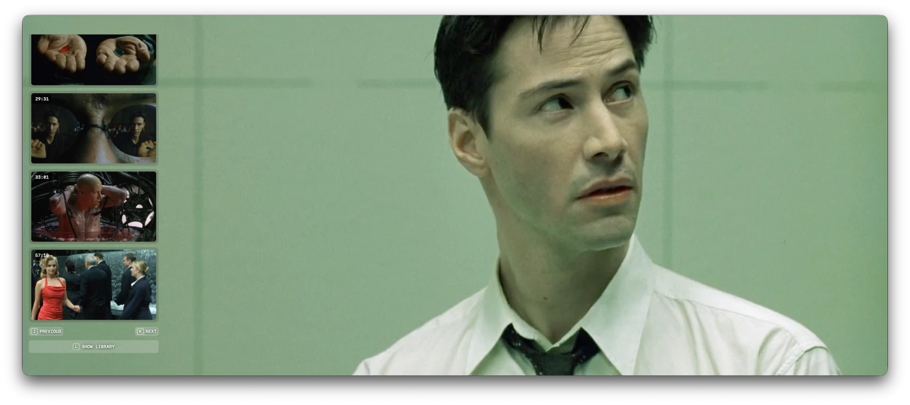
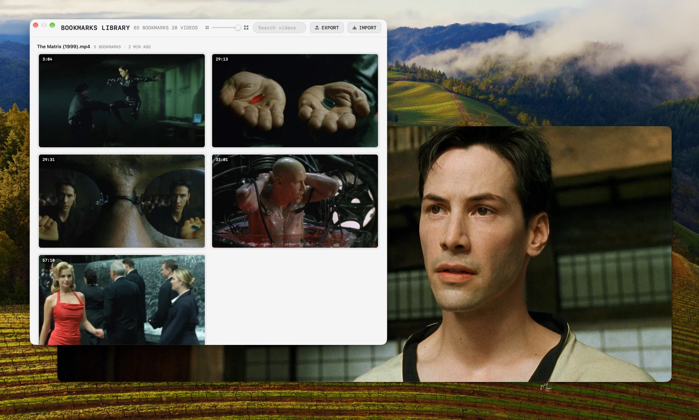

# Bookmarks Pro for IINA

Bookmarks Pro is a plugin for [IINA](https://iina.io), the video player for Mac. It's made for video editors, clippers, content creators, and anyone who wants to make and manage lots of bookmarks in their videos.

- Press <kbd>B</kbd> to bookmark a moment in a video.
- Press <kbd>J</kbd> and <kbd>K</kbd> to jump to the previous and next bookmark, without opening anything.
- Press <kbd>N</kbd> to show or hide the stack of thumbs at any time.
- When you open a video that already has bookmarks, a stack of their thumbs appears on the left for a moment. Hover over it to keep it open. Click a bookmark to jump to that moment, or hover over its thumb to play a preview (needs [ffmpeg](#optional-ffmpeg)).
- Press <kbd>L</kbd> to open your library, which shows every bookmark in every video.
  - Search by video name, and make the thumbs bigger or smaller with a slider.
  - Click a bookmark to open that video at that moment, in a new window.
  - Back up all your bookmarks to one file with **Export**, and bring them back on any Mac with **Import**.
- Your bookmarks stay with the video, even if you rename it or move it to another folder.

**Download clips** (needs [ffmpeg](#optional-ffmpeg)). Turn any bookmark into a video file with one click: the 5, 10 or 30 seconds after it, in full quality with sound, saved to your Downloads folder. See [Save a clip](#save-a-clip).





## Keyboard shortcuts

| Key | What it does |
|---|---|
| <kbd>B</kbd> | Bookmark this moment |
| <kbd>N</kbd> | Show or hide this video's bookmarks |
| <kbd>J</kbd> | Go to the previous bookmark |
| <kbd>K</kbd> | Go to the next bookmark |
| <kbd>L</kbd> | Open the library of all your bookmarked videos |

You can also find everything in IINA's **Plugin** menu.

## What you can do

### Bookmark a moment

Press <kbd>B</kbd> while a video is playing. A small card in the top-left corner shows the thumb you saved. The video keeps playing.

### See your bookmarks

Press <kbd>N</kbd>. Your bookmarks appear as a column of thumbs on the left side of the video.

- **Click** a thumb to jump to that moment.
- **Hover** over a thumb to see a short preview of what happens next. This needs ffmpeg (see below).
- **Click the ✕** on a thumb to delete that bookmark.

<kbd>J</kbd> and <kbd>K</kbd> take you to the previous and next bookmark, even when the thumbs are hidden. After the last bookmark, <kbd>K</kbd> starts again at the first one.

When you open a video that has bookmarks, they show up for a moment on their own. A thin bar at the bottom also shows where each bookmark is in the video.

### Save a clip

Hover over a bookmark and point at the **↓** in its corner. Choose **5S**, **10S** or **30S**. A clip of that length, starting at the bookmark, is saved to your **Downloads** folder. It has sound and full video quality.

A small note in the corner tells you when the clip is ready. Click the note to see the file in Finder.

Clips are named like this: `IINA Clip - The Matrix (1999) - 15m15s.mp4`. To find all your clips, search Finder for **iina clip**.

This needs ffmpeg (see below).

### Browse all your videos

Press <kbd>L</kbd> to open the library. It shows every video you have bookmarked, with the most recently watched at the top.

- **Search** for a video by its name.
- Use the **slider** to make the thumbs bigger or smaller.
- **Click** a bookmark to open the video at that moment, in a new window.
- If a video has been moved, click **Locate…** and show the plugin where it is now.

### Back up your bookmarks

In the library, click **Export** to save all your bookmarks in one zip file. You can choose:

- **Full backup**: everything, including the hover previews.
- **Small backup**: everything except the hover previews. The plugin makes them again when you open each video.

Click **Import** to bring bookmarks back from a backup, on this Mac or another one. Import only adds bookmarks. It never deletes or changes the ones you already have.

### Chapters

Your bookmarks are also added to the video's chapters, so you can see them in IINA's chapter list.

## Install

You need IINA 1.4 or newer.

**Option 1: from GitHub, inside IINA**

1. Open IINA and go to **Settings → Plugins**.
2. Click **Install from GitHub…**
3. Type `aminozuur/iina-bookmarks-pro` and click **Install**.

**Option 2: download the file**

1. Go to the [Releases page](https://github.com/aminozuur/iina-bookmarks-pro/releases) and download the latest `.iinaplgz` file.
2. Double-click it. IINA opens and asks if you want to install it.

After installing, check that **Bookmarks Pro** is turned on under **Settings → Plugins**. Then press <kbd>B</kbd> in any video to try it.

## Optional: ffmpeg

Two features need a free tool called [ffmpeg](https://ffmpeg.org):

- the short previews when you hover over a bookmark
- saving clips

The easiest way to install it is with [Homebrew](https://brew.sh). Open the Terminal app and run:

```bash
brew install ffmpeg
```

Everything else works without ffmpeg. If you install it later, your existing bookmarks get their previews the next time you open each video.

## Privacy

Everything stays on your Mac. The plugin never connects to the internet.

Your bookmarks, thumbs and previews are saved in IINA's folder for this plugin. Clips you save go to your Downloads folder.

The plugin asks IINA for three permissions:

- **Show OSD**: to show short messages on the video, like "Bookmark 2/6".
- **Video overlay**: to show the bookmark thumbs over the video.
- **File system**: to save your bookmarks, to recognize your videos, and to run ffmpeg.

A backup file has thumbs of your videos and the names and locations of your video files. Keep it somewhere private.

## How the plugin recognizes videos

The plugin recognizes a video by its content, not by its name or location. You can rename a video or move it to another folder, and your bookmarks stay with it. This also means a backup works on another Mac, wherever the videos are saved there.

To do this quickly, the plugin reads only three small parts of the file: the beginning, the middle and the end. This takes a fraction of a second, even for very large files.

Two identical copies of a video share the same bookmarks. If you convert a video to another format, it counts as a new video.

Videos you stream from the internet are recognized by their address.

## Change the shortcuts

The keys are set at the top of `main.js`:

```js
const ADD_KEY = "b";
const SHOW_KEY = "n";
const PREV_KEY = "j";
const NEXT_KEY = "k";
const LIBRARY_KEY = "l";
```

Change a letter, save the file, and choose **Plugin → Reload All Plugins** in IINA.

## For developers

To work on the plugin, link this folder into IINA:

```bash
/Applications/IINA.app/Contents/MacOS/iina-plugin link .
```

Restart IINA, then turn on the plugin under **Settings → Plugins**. After you change the code, choose **Plugin → Reload All Plugins**. To remove the link, run `iina-plugin unlink .`.

The files:

- `Info.json`: the plugin's name, version and permissions
- `main.js`: shortcuts, saving, recognizing videos, clips, export and import
- `overlay.html`: everything shown over the video
- `library.html`: the library window

To publish a new version, raise `version` and `ghVersion` in `Info.json`, then push a tag like `v1.2.0`. GitHub then builds the `.iinaplgz` file and creates a release.

## Author

Feel free to contact me if you have any questions or feedback about this plugin.

**Amin Eftegarie**

Email: [amin@eftegarie.com](mailto:amin@eftegarie.com)  
Website: [eftegarie.com](https://eftegarie.com/)  
Twitter: [@eftegarie](https://x.com/eftegarie)

## License

MIT. See [LICENSE](LICENSE).
